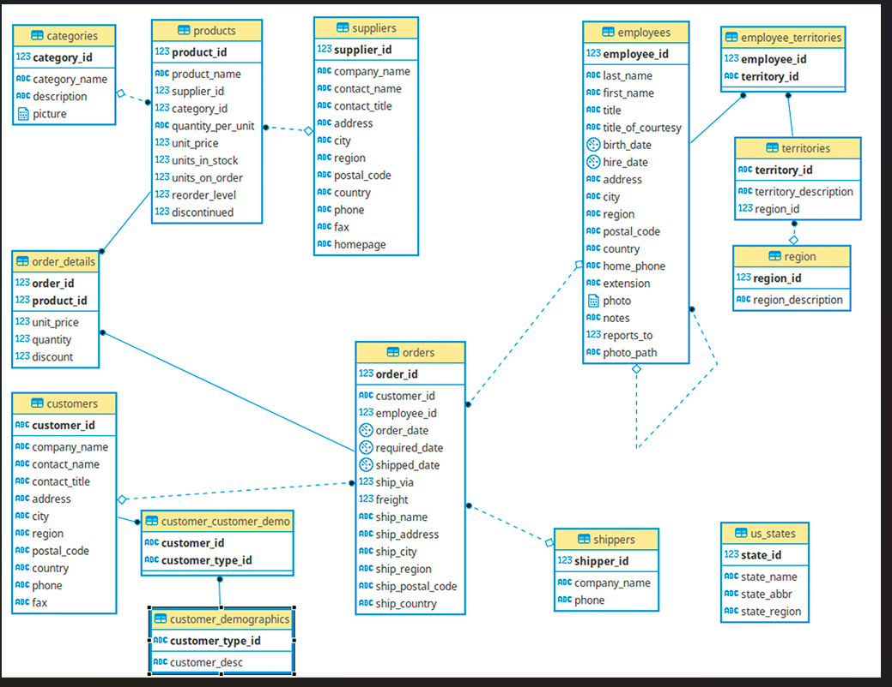
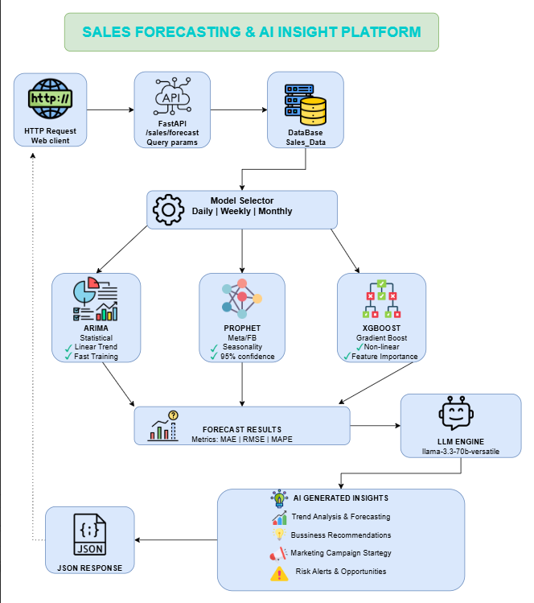

<div align="center">

# 🚀 Sales Forecasting API with FastAPI

**A powerful, production-ready Sales Forecasting API built with FastAPI, featuring multiple ML models, LLM analysis, and comprehensive data analytics.**

[](https://www.python.org/)
[](https://fastapi.tiangolo.com/)
[](LICENSE)

</div>

---

## 📋 Table of Contents

- [Overview](#-overview)
- [Features](#-features)
- [Tech Stack](#-tech-stack)
- [Quick Start](#-quick-start)
- [Configuration](#-configuration)
- [API Documentation](#-api-documentation)
- [Project Structure](#-project-structure)
- [Database Schema](#-database-schema)
- [Application Flow](#-application-flow)
- [Usage Examples](#-usage-examples)
- [Development](#-development)

---

## 🎯 Overview

This is a comprehensive Sales Forecasting API that leverages advanced machine learning models to predict future sales trends. The application provides:

- **Multiple Forecasting Models**: ARIMA, Prophet, and XGBoost
- **Flexible Forecasting**: Product-wise and customer-wise sales predictions
- **AI-Powered Analysis**: LLM integration for intelligent forecast interpretation
- **Data Analytics**: Comprehensive statistical analysis and data preparation tools
- **Production Ready**: Built with best practices, logging, health checks, and monitoring

---

## ✨ Features

### 🔮 Forecasting Capabilities
- **Product Sales Forecasting**: Predict future sales for specific products
- **Customer Sales Forecasting**: Forecast sales by customer (with optional product filtering)
- **Multiple Time Frequencies**: Daily, Weekly, and Monthly forecasts
- **Model Selection**: Choose between ARIMA, Prophet, or XGBoost models
- **Model Evaluation**: Automatic calculation of forecasting accuracy metrics

### 🤖 AI Integration
- **LLM Analysis**: Intelligent interpretation of forecast results using Groq API
- **Automated Insights**: Get actionable insights from your forecasts

### 📊 Data Analytics
- **Table Statistics**: Comprehensive statistical analysis of database tables
- **Data Preparation**: Tools for aggregating and preparing sales data
- **Summary Statistics**: Detailed insights into your data

### 🛠️ Developer Experience
- **Interactive API Docs**: Auto-generated Swagger/OpenAPI documentation
- **Log Viewer**: Built-in web-based log viewing interface
- **Health Checks**: Monitor application status
- **Structured Logging**: Comprehensive logging system
- **SSL Support**: Secure connections with SSL/TLS

---

## 🛠️ Tech Stack

### Core Framework
- **FastAPI** - Modern, fast web framework for building APIs
- **Uvicorn** - Lightning-fast ASGI server
- **SQLAlchemy** - SQL toolkit and ORM

### Machine Learning
- **Prophet** - Facebook's time series forecasting tool
- **ARIMA** (via `pmdarima`) - Auto-regressive integrated moving average
- **XGBoost** - Gradient boosting framework
- **Statsmodels** - Statistical modeling library
- **Scikit-learn** - Machine learning utilities

### Data Processing
- **Pandas** - Data manipulation and analysis
- **NumPy** - Numerical computing

### AI/LLM
- **LangChain** - LLM application framework
- **Groq** - High-performance LLM inference

### Other
- **Matplotlib** - Data visualization
- **API Analytics** - API monitoring and analytics

---

## 🚀 Quick Start

### Prerequisites

- Python 3.11
- `uv` package manager (recommended) or `pip`
- Database (SQLite or PostgreSQL)

### Installation

1. **Clone the repository**
   ```bash
   git clone https://github.com/mubashirsidiki/FastCrate.git
   cd FastCrate
   ```

2. **Install uv (if not already installed)**
   ```bash
   pip install uv
   ```

3. **Install dependencies**
   ```bash
   uv sync
   ```
   
   > ⚠️ **Note**: If OneDrive causes issues, use:
   > ```bash
   > uv sync --link-mode=copy
   > ```

4. **Configure environment variables**
   
   Create a `.env` file in the project root:
   ```env
   database_user=your_db_user
   database_password=your_db_password
   database_host=localhost
   database_port=5432
   database_name=your_database
   groq_api_key=your_groq_api_key
   model_name=your_preferred_model
   API_KEY=your_api_key_optional
   ```

5. **Run the application**
   ```bash
   uv run python main.py
   ```
   
   Or with custom options:
   ```bash
   uv run python main.py --port 8000 --debug
   ```

6. **Access the API**
   - **API Base URL**: http://localhost:8000
   - **Interactive Docs**: http://localhost:8000/docs
   - **Alternative Docs**: http://localhost:8000/redoc

---

## ⚙️ Configuration

### Command Line Arguments

```bash
python main.py [OPTIONS]
```

| Option | Description | Default |
|--------|-------------|---------|
| `-p, --port` | Port number | 8000 |
| `-d, --debug` | Enable debug mode (auto-reload) | False |
| `-w, --workers` | Number of worker processes | 1 |
| `-k, --keyfile` | Path to SSL private key file | None |
| `-c, --certfile` | Path to SSL certificate file | None |

### Environment Variables

All configuration is managed through environment variables loaded from `.env`:

- `database_user` - Database username
- `database_password` - Database password
- `database_host` - Database host
- `database_port` - Database port
- `database_name` - Database name
- `groq_api_key` - Groq API key for LLM analysis
- `model_name` - Preferred LLM model name
- `API_KEY` - Optional API key for authentication

---

## 📚 API Documentation

### Health Check

**GET** `/api/v1/healthcheck`

Check if the application is running properly.

**Response:**
```json
{
  "status": "healthy",
  "timestamp": "2024-01-01T00:00:00"
}
```

### Log Viewer

**GET** `/api/v1/logs`

Access the built-in logger service to view application logs through a web interface.

> 💡 **Tip**: If after clicking the "Fetch Logs" button you see nothing, try switching to incognito mode in your browser.

### Data Analysis

#### Get Table Statistics

**GET** `/api/v1/data_analysis/table_stats?table_name={table_name}`

Get comprehensive statistics for a database table.

**Parameters:**
- `table_name` (required): Name of the table to analyze

**Response:**
```json
{
  "table": "products",
  "rows": 100,
  "columns": 5,
  "sample_data": [...],
  "summary": {...},
  "missing_values": {...}
}
```

### Sales Forecasting

#### Product Sales Forecast

**GET** `/api/v1/data_forecast/sales/product_sales_forecast`

Forecast future sales for a specific product.

**Parameters:**
- `product_name` (required): Product name to forecast
- `periods_ahead` (optional): Number of periods to forecast (default: 3)
- `model` (optional): Forecasting model - `arima`, `prophet`, or `xgboost` (default: `arima`)
- `frequency` (optional): Forecast frequency - `daily`, `weekly`, or `monthly` (default: `monthly`)

**Example Request:**
```bash
GET /api/v1/data_forecast/sales/product_sales_forecast?product_name=Chai&periods_ahead=6&model=prophet&frequency=monthly
```

**Response:**
```json
{
  "product": "Chai",
  "last_known_month": "Dec-2023",
  "history": [...],
  "forecast": [...],
  "evaluation_metrics": {
    "mae": 123.45,
    "rmse": 234.56,
    "mape": 5.67
  },
  "model_info": {...},
  "llm_analysis": "Based on the forecast..."
}
```

#### Customer Sales Forecast

**GET** `/api/v1/data_forecast/sales/customer_sales_forecast`

Forecast future sales for a specific customer.

**Parameters:**
- `customer_name` (required): Customer name to filter
- `product_name` (optional): Optional product name to filter
- `periods_ahead` (optional): Number of periods to forecast (default: 3)
- `model` (optional): Forecasting model - `arima`, `prophet`, or `xgboost` (default: `arima`)
- `frequency` (optional): Forecast frequency - `daily`, `weekly`, or `monthly` (default: `monthly`)

**Example Request:**
```bash
GET /api/v1/data_forecast/sales/customer_sales_forecast?customer_name=Alfreds Futterkiste&product_name=Chai&periods_ahead=3&model=xgboost&frequency=monthly
```

**Response:**
```json
{
  "customer": "Alfreds Futterkiste",
  "product": "Chai",
  "last_known_month": "Dec-2023",
  "history": [...],
  "forecast": [...],
  "evaluation_metrics": {...},
  "model_info": {...},
  "llm_analysis": "The forecast indicates..."
}
```

---

## 📁 Project Structure

```
FastCrate/
├── core/                    # Core application logic
│   ├── logger/             # Logging system
│   ├── middlewares/        # Custom middlewares
│   ├── server.py           # FastAPI app initialization
│   └── utils/              # Utility functions
├── modules/                # Feature modules
│   ├── data/              # Data preparation and queries
│   │   ├── sql_queries/   # SQL query definitions
│   │   └── SummaryStats.py
│   ├── healthcheck/       # Health check endpoints
│   ├── LLM/              # LLM integration
│   ├── logviewer/        # Log viewer interface
│   ├── models/           # Forecasting models
│   │   ├── Arima.py
│   │   ├── Prophet.py
│   │   ├── XG_boost.py
│   │   └── predict.py
│   └── ORM/              # Database ORM
├── logs/                  # Application logs
├── config.py             # Configuration management
├── main.py               # Application entry point
├── pyproject.toml        # Project dependencies
└── README.md             # This file
```

---

## 🗄️ Database Schema

The application uses a relational database (SQLite or PostgreSQL) with the following schema:



The schema includes tables for:
- **Customers**: Customer information
- **Products**: Product catalog
- **Orders**: Order records
- **Order Details**: Detailed order line items

---

## 🔄 Application Flow

The following diagram illustrates the application's architecture and data flow:



### Flow Description:

1. **Client Request** → API receives forecasting request
2. **Data Retrieval** → Query database for historical sales data
3. **Data Preparation** → Process and aggregate time series data
4. **Model Selection** → Choose appropriate forecasting model
5. **Forecast Generation** → Generate predictions using selected model
6. **Model Evaluation** → Calculate accuracy metrics
7. **LLM Analysis** → Get intelligent insights from Groq API
8. **Response** → Return comprehensive forecast results

---

## 💡 Usage Examples

### Example 1: Forecast Product Sales with ARIMA

```bash
curl "http://localhost:8000/api/v1/data_forecast/sales/product_sales_forecast?product_name=Chai&periods_ahead=6&model=arima&frequency=monthly"
```

### Example 2: Forecast Customer Sales with Prophet

```bash
curl "http://localhost:8000/api/v1/data_forecast/sales/customer_sales_forecast?customer_name=Alfreds%20Futterkiste&periods_ahead=3&model=prophet&frequency=weekly"
```

### Example 3: Get Table Statistics

```bash
curl "http://localhost:8000/api/v1/data_analysis/table_stats?table_name=products"
```

### Example 4: Using Python Requests

```python
import requests

# Product sales forecast
response = requests.get(
    "http://localhost:8000/api/v1/data_forecast/sales/product_sales_forecast",
    params={
        "product_name": "Chai",
        "periods_ahead": 6,
        "model": "prophet",
        "frequency": "monthly"
    }
)

forecast_data = response.json()
print(f"Forecast: {forecast_data['forecast']}")
print(f"LLM Analysis: {forecast_data['llm_analysis']}")
```

---

## 🔧 Development

### Adding a New Package

```bash
uv add package_name
# Example: uv add pandas
```

### Running in Debug Mode

```bash
uv run python main.py --debug
```

This enables auto-reload on file changes.

### Running with Multiple Workers

```bash
uv run python main.py --workers 4
```

### SSL Configuration

```bash
uv run python main.py --keyfile /path/to/key.pem --certfile /path/to/cert.pem
```

### Testing the Application

1. **Interactive API Documentation**
   - Visit: http://localhost:8000/docs
   - Test endpoints directly from the browser

2. **Health Check**
   ```bash
   curl http://localhost:8000/api/v1/healthcheck
   ```

3. **View Logs**
   - Visit: http://localhost:8000/api/v1/logs
   - Use the web interface to view application logs

---

## 📝 Notes

### Model Selection Guide

- **ARIMA**: Best for stationary time series, works well with limited data
- **Prophet**: Excellent for data with seasonality and trends, handles missing data well
- **XGBoost**: Requires more data (60+ daily, 20+ weekly, 12+ monthly), best for complex patterns

### Data Requirements

- Minimum 3 data points required for any forecast
- XGBoost requires more data points for optimal performance
- More historical data generally leads to better forecasts

---

## 📄 License

This project is licensed under the MIT License - see the [LICENSE](LICENSE) file for details.

---

<div align="center">

**Built with ❤️ using FastAPI**

⭐ Star this repo if you find it helpful!

</div>
